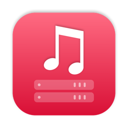

<p align="center">
  
</p>

# Apple Music API

A small macOS menu bar app that lets you query and control Apple Music over HTTP. It's built for home
automation, in particular Home Assistant's [iTunes integration](https://www.home-assistant.io/integrations/itunes/),
and is a Swift rewrite of Jon Maddox's [itunes-api](https://github.com/maddox/itunes-api).

- See what's playing, with artwork
- Play, pause, skip, volume, mute, shuffle and repeat
- Start a playlist by name
- Choose AirPlay speakers and set their volume
- Lives in the menu bar, with an optional start at login

## Install

Requires macOS 14 or later and Xcode (for the Swift toolchain).

```sh
git clone https://github.com/adamlc/apple-music-api.git
cd apple-music-api
script/install
```

This builds the app, copies it to `~/Applications` and starts it.

## Setup

1. macOS asks whether Apple Music API may control Music the first time it's used. Choose **Allow**.
2. Click the menu bar icon to change the port (default `8181`) or turn on **Start at Login**.
3. In Home Assistant, add the server to `configuration.yaml`:

   ```yaml
   media_player:
     - platform: itunes
       host: 192.168.1.50   # the Mac running Apple Music API
   ```

   The port is `8181` in both, so there's nothing else to set. If you change the port in the menu
   bar, add a matching `port:` line.

## API

`PUT` endpoints that change playback return the same JSON as `/now_playing`. Fields can be sent as a
form body or as query parameters.

```
GET /_ping
GET /now_playing
GET /artwork
PUT /play | /pause | /playpause | /stop | /previous | /next
PUT /volume                        level=0-100
PUT /mute                          muted=true|false
PUT /shuffle                       mode=songs|albums|groupings|off
PUT /repeat                        mode=all|one|off
GET /playlists
PUT /playlists/:id/play
GET /airplay_devices
GET /airplay_devices/:id
PUT /airplay_devices/:id/on | /off
PUT /airplay_devices/:id/volume    level=0-100
```

- Playlist ids are slugs of the name (`Outkast: The '90s` becomes `outkast-the-90s`). Playlists that
  share a name get a short suffix after the first, and `PUT /playlists/:id/play` also takes a
  persistent id.
- Artwork comes from the current track when it's in your library. Songs streamed from the Apple Music
  catalog have no artwork that AppleScript can read, so for those the artist, title and album are
  looked up on Apple's public iTunes Search API and the cover is fetched from there (600px). Results are
  cached per track. That's the only request the app makes to the internet.
- If Music isn't running, `/now_playing` reports `{"player_state": "stopped"}` and most other
  requests return `503`. Only play, playpause and playing a playlist launch Music.
- It's compatible with the original itunes-api, with a few differences: unknown playlists or AirPlay
  devices return `404`, invalid parameters return `400`, and a playlist's `loved` comes from its
  favourite flag, and `album` is just the album name, with the release year in a separate `year` field.

## Development

```sh
swift test          # unit tests (these don't talk to Music)
script/bundle       # build "build/Apple Music API.app"
script/install      # bundle, install to ~/Applications and restart
```

The app is signed ad hoc, so macOS may ask for permission again after a rebuild. See
[CLAUDE.md](CLAUDE.md) for how it works, and for the Apple Events and macOS permission pitfalls.

## A note on how it was made

This project is vibe coded: it was written with [Claude Code](https://claude.com/claude-code), with me
steering and testing it against my own Home Assistant setup. It has unit tests and has worked well for
me, but it's only been tried on one setup, so expect rough edges and read the code before you trust it.

## Licence

MIT, see [LICENSE](LICENSE). Based on [itunes-api](https://github.com/maddox/itunes-api) by Jon Maddox.
